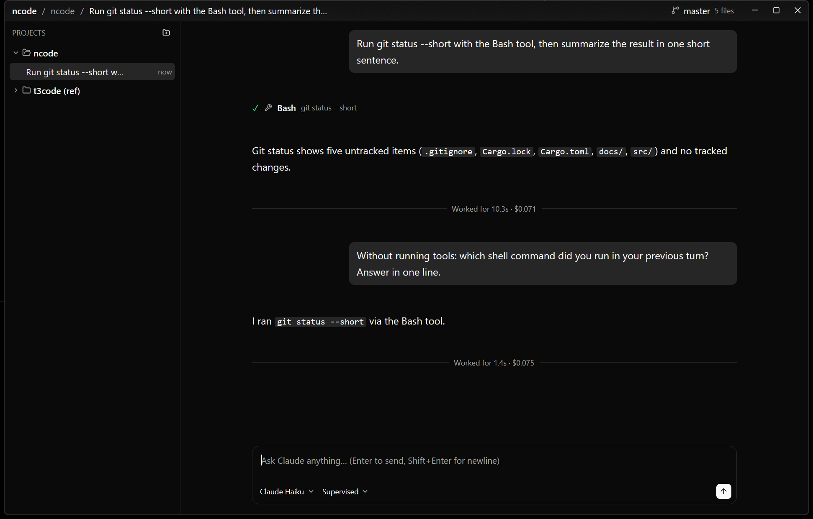

# ncode

A native port of [T3 Code](https://github.com/pingdotgg/t3code) in Rust: a GUI for driving Claude Code,
rendered on the GPU by [gpui-kit](https://gpui-kit.com) with its **gpui-fast** backend. There is no
Electron, no Node server, no WebSocket and no browser engine. It is a single native binary with a retained-mode UI.



> **Status: proof of concept.** It was ported from upstream `7e565c51` (2026-11-11) and covers project
> organisation, chats, Claude Code on Windows, and the branch applet.
> [docs/feature-analysis.md](docs/feature-analysis.md) lists what a full port still needs.

## Features

- **Projects.** Add a folder with the native picker. You can rename, reorder, collapse and remove projects.
  Threads are grouped under their project, newest first, with inline rename and two-click delete.
- **Chats.** The timeline is virtualized and follows the newest message. It shows streamed markdown,
  thinking blocks, a collapsible tool work log, approval cards and a summary after each turn. The composer
  keeps a draft per thread and has model and runtime-mode pickers plus a Stop button.
- **Claude Code.** ncode drives the `claude` CLI over its stream-json control protocol, which is the
  protocol the Agent SDK uses. Each thread keeps one long-lived session, and sessions resume after a
  restart. Approvals, interrupts, and live model or permission-mode changes are supported.
- **Branch applet** (top right). It shows the current branch or detached SHA, dirty stats, ahead/behind
  counts and the open PR (via `gh`). Its popover switches to a branch or creates one.

### Why native

Each loaded thread owns its own timeline entity. A streaming token re-renders only that chat. The
sidebar and header stay untouched, and the timeline only lays out rows that are on screen.

## Requirements

- Rust 1.88+ (edition 2024)
- [Claude Code](https://docs.claude.com/en/docs/claude-code), installed and logged in
- `git` on `PATH`; [`gh`](https://cli.github.com) is optional, for PR status
- Built and tested on Windows 11. Linux and macOS should build but are untested.

## Build and run

```sh
cargo run              # dev build (dependencies compiled with opt-level 3)
cargo run --release    # release build, no console window
cargo test
```

The first build compiles GPUI and takes a few minutes.

## Configuration

| Env var | Purpose |
| --- | --- |
| `NCODE_HOME` | Data directory. The default is `%APPDATA%\ncode` and state lives in `state.sqlite`. ncode never touches T3 Code's `~/.t3/userdata`. |
| `NCODE_CLAUDE_PATH` | Explicit path to the Claude binary. Otherwise ncode searches `PATH` + `PATHEXT` and follows npm `.cmd` shims to the bundled `claude.exe` (or `node cli.js`). As a last resort it tries `~/.local/bin/claude.exe`. |
| `RUST_LOG` | Log filter, for example `ncode=debug`. |

## Runtime modes

| ncode | Claude `--permission-mode` |
| --- | --- |
| Supervised | `default`: asks before running tools |
| Auto-accept edits | `acceptEdits` |
| Full access | `bypassPermissions` |
| Plan | `plan`: read-only planning |

## Windows notes

- Claude runs with plain pipes; no ConPTY is involved. Arguments are passed as a vector, so no
  shell quoting is needed.
- Child processes start with `CREATE_NO_WINDOW`, so no console windows flash.
- Stop and delete use `taskkill /T` to end Claude and every tool process it started.
- Session variables inherited from a parent Claude Code (`CLAUDECODE`, `CLAUDE_CODE_SESSION_ID`, …) are
  stripped. Without that, ncode launched from inside Claude Code would join the parent's session.

## Project layout

| Path | Role |
| --- | --- |
| `src/main.rs` | App bootstrap and window |
| `src/model.rs` | Domain types: projects, threads, timeline items, runtime modes |
| `src/store.rs` | SQLite persistence and migrations |
| `src/claude.rs` | Claude Code process driver and stream-json parser |
| `src/git.rs` | Git status (`--porcelain=v2` + numstat), branch list, switch/create, `gh pr view` |
| `src/state.rs` | `AppState` and the per-thread `Timeline` entities |
| `src/ui/` | Workspace, sidebar, chat pane, branch applet |
| `docs/feature-analysis.md` | Upstream feature analysis: what runs under the hood and what remains to port |

## Credits

ncode is a port of [T3 Code](https://github.com/pingdotgg/t3code) by T3 Tools Inc. (MIT) and is built on
[gpui-kit](https://github.com/longbridge/gpui-kit) and [GPUI](https://github.com/zed-industries/zed).

## License

[MIT](LICENSE)
